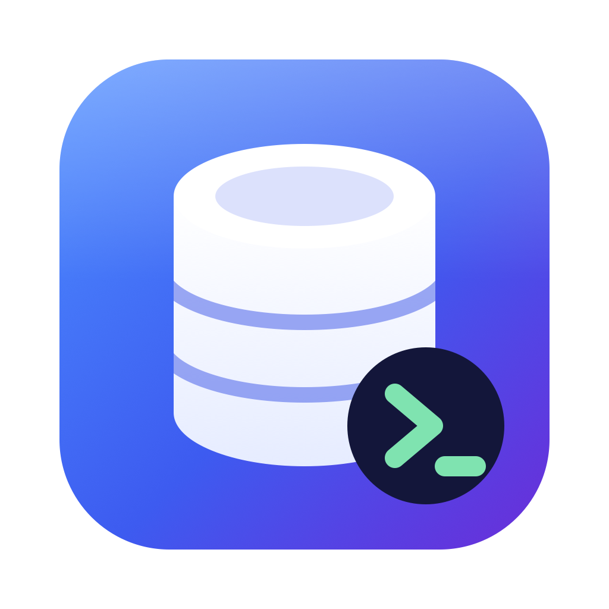
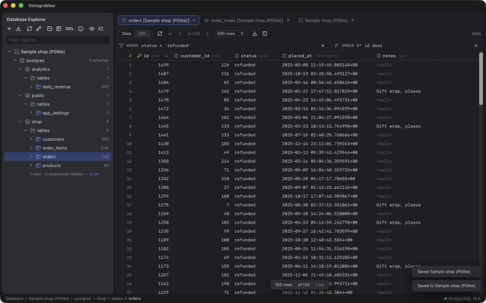
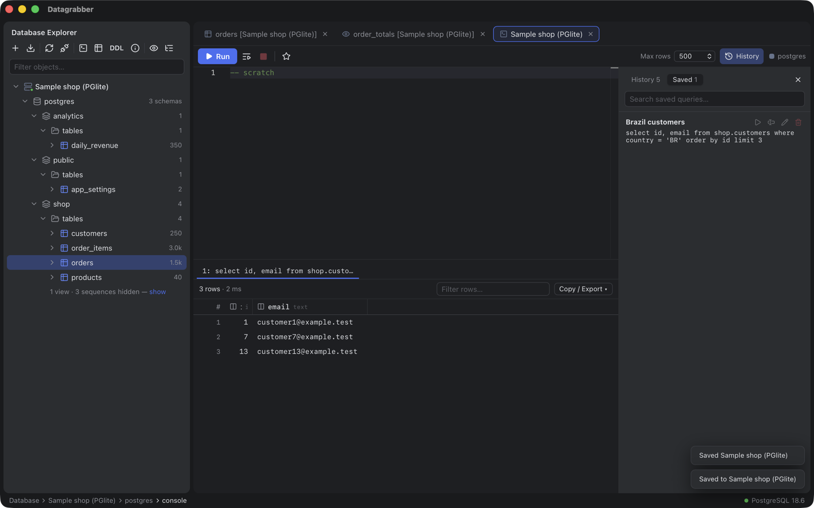
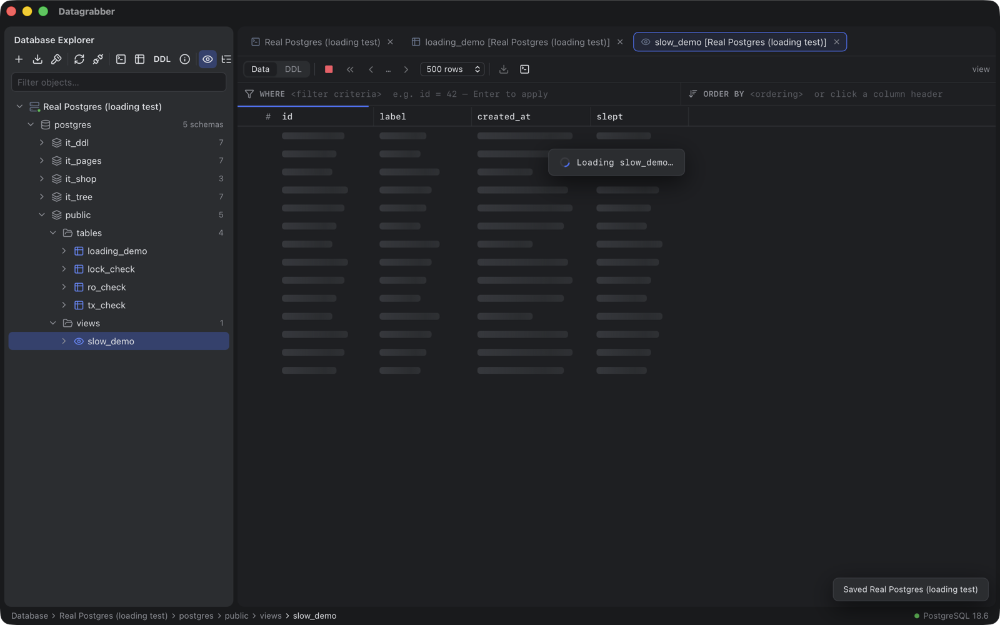
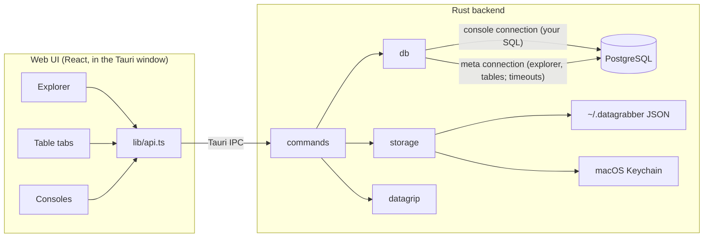

<p align="center">
  
</p>

<h1 align="center">Datagrabber</h1>

<p align="center">
  A fast, safe PostgreSQL desktop client for macOS. Rust + Tauri, React + Monaco.<br />
  Explorer, table tabs and SQL consoles — designed so browsing production never hangs, never commits behind your back, and never touches your passwords outside the Keychain.
</p>

<p align="center">
  <a href="https://github.com/higorhlg/datagrabber/actions/workflows/ci.yml"></a>
  <a href="LICENSE"></a>
  
</p>



## Features

- **Database Explorer** — connection → database → schema → tables, with row estimates, columns,
  keys, foreign keys and indexes. Views, sequences and routines stay out of the way until you ask
  for them, and **Properties…** explains any object (is it a table or a view?).
- **Table tabs** — click a table to open it: WHERE and ORDER BY bars, click-to-sort headers, paging,
  `count(*)` on demand, copy/export (TSV, CSV, JSON, INSERT) and its DDL.
- **SQL consoles** — Monaco editor with schema-aware autocomplete (including table aliases),
  ⌘↵ runs the statement under the cursor, ⇧⌘↵ runs everything, errors are marked where PostgreSQL
  points, ■ cancels on the server.
- **History and saved queries per database** — every run is recorded; ★ keeps the good ones, one
  click reruns them.
- **Clear loading states** — connecting spinners, schema skeletons, a skeleton grid with the real
  column names, previous rows kept (faded) while the next page loads, and a Stop button.
- **DataGrip import** — brings in your DataGrip data sources (`~/DataGripProjects/.idea`), and can
  copy the passwords DataGrip saved in the macOS Keychain — with your approval for each one.

<table>
  <tr>
    <td></td>
    <td></td>
  </tr>
  <tr>
    <td align="center"><sub>Console, results, history and saved queries</sub></td>
    <td align="center"><sub>A slow view: skeleton grid, timer and ■ Stop</sub></td>
  </tr>
</table>

## Safe by design

Database GUIs make it easy to hurt production by accident. Datagrabber's defaults are built around that:

| Risk | What Datagrabber does |
| --- | --- |
| `select * from huge_table` streams millions of rows | Consoles fetch through a server-side cursor (`DECLARE … FETCH n`), so the server stops at the row cap (500 by default). |
| Clicking a table queues behind a migration's lock | The explorer and table tabs run on their own connection with `lock_timeout = 5s` and `statement_timeout = 30s`; you get a clear message, never a hang. |
| A tool quietly commits your open transaction | Inside a `BEGIN` you opened, the cursor joins your transaction; it never wraps it in its own `COMMIT`. |
| Writing to prod by mistake | Connections can be read-only (every session starts with read-only transactions). Imported names containing "prod" start read-only, and prod connections are red. |
| Passwords in config files | Passwords live only in the macOS Keychain. Connections, consoles and history are plain JSON files in `~/.datagrabber`, owner-only. |
| Websites talking to a local server | There is no local server: the UI calls Rust directly through Tauri IPC. |

Read-only mode is a guard rail, not a permission boundary — use a read-only database role for real enforcement.

## Install

**From source** (macOS, Node 24+, pnpm 10, Rust stable):

```sh
git clone https://github.com/higorhlg/datagrabber.git
cd datagrabber
pnpm install
pnpm build          # → src-tauri/target/release/bundle/macos/Datagrabber.app
```

**Prebuilt:** pushing a `v*` tag builds a universal (Apple Silicon + Intel) `.dmg` and attaches it to a
GitHub release; check the Releases page. It is not notarized yet; on first launch right-click the app → Open.

Want a database to try it on? `pnpm sample-db` serves a fake shop on `127.0.0.1:54329` (in-memory
PGlite, any user/password).

## Architecture



| Path | Responsibility |
| --- | --- |
| `src-tauri/src/commands/` | The UI's API: thin Tauri commands per area (connections, queries, explorer, library, DataGrip) |
| `src-tauri/src/db/` | Sessions (TLS, read-only, timeouts, cancel), cursor-capped execution, introspection, DDL |
| `src-tauri/src/storage/` | Connections, consoles, history, saved queries (atomic, owner-only JSON) and Keychain secrets |
| `src-tauri/src/datagrip/` | DataGrip import and Keychain password copy |
| `web/src/app/` | App shell: connection state, tabs, status bar |
| `web/src/features/` | Explorer, table tabs, consoles, connection dialogs |
| `web/src/ui/` | Shared components: results grid, dialogs, loading states |
| `web/src/lib/` | API client, types, SQL splitter and alias resolver, Monaco setup |

## Development

```sh
pnpm app            # run with hot reload
pnpm lint           # Biome (TypeScript, CSS)
pnpm typecheck
pnpm test           # web unit tests + Rust unit/integration tests
```

Rust integration tests run against a real PostgreSQL started from npm (no Docker):

```sh
pnpm real-db                                   # terminal 1, port 54330
DATAGRABBER_TEST_PG=54330 pnpm test            # terminal 2
```

They cover the row cap on a 5M-row query, never committing a user transaction, per-connection
read-only, server-side cancel, giving up on a locked table within 5 s, introspection and DDL.

`pnpm e2e --scenario sample|loading|passwords|import --home /tmp/dg` builds the app and drives the
real window through an in-app self-test (connect, browse, table tabs, consoles, saved queries,
loading states, DataGrip import) — it opens an app window while it runs.

## Status

Built for PostgreSQL on macOS. Not yet: editing rows in the grid, ER diagrams, schema compare,
other databases, Windows/Linux builds (Tauri supports them; untested).

Datagrabber is an independent project and is not affiliated with JetBrains. DataGrip is a trademark
of JetBrains s.r.o.; it is mentioned only to describe import compatibility.

## License

[Apache-2.0](LICENSE)
